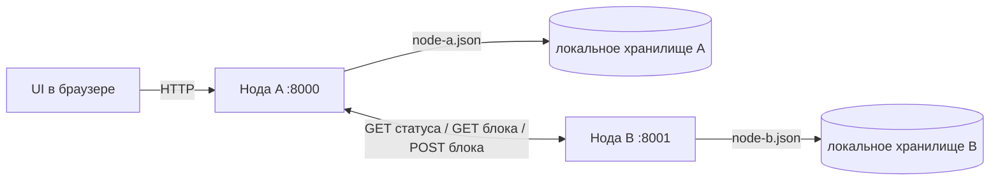

# Архитектура сетевого взаимодействия — спринт 4

## Решение

Каждая нода — отдельный процесс `python3 src/node.py` со своим `node_id`, HTTP-адресом и JSON-файлом цепочки. `Node` не разделяет объекты или файл с другими экземплярами: после успешного создания или приёма блока он атомарно заменяет только свой файл. Все данные обмена — JSON UTF-8 формата цепочки версии 2.



Выбран простой синхронный HTTP/JSON по известному адресу. Он прозрачен для демонстрации, проверяется штатной библиотекой Python и не требует брокера сообщений. Автоматическое обнаружение узлов, широковещательная рассылка и автоматическая синхронизация намеренно не реализованы: это не требуется в спринте 4. Нода может получить конкретный блок через `GET`, проверить его и принять через `POST`.

## Инварианты приёма

До записи входящий блок разбирается в новый объект; исходный JSON не меняет память ноды. Приёмник проверяет версию и обязательные поля, хэши и поля каждой записи, непрерывность индекса, `previous_hash`, хэш блока, отсутствие повторов `record_id` и непустой список записей. Лишь затем блок добавляется в цепочку и сохраняется. При любой ошибке высота и файл приёмника не меняются.

Если блок уже есть на этой высоте и его хэш совпадает, это `DUPLICATE_BLOCK`; другой блок на занятой высоте — `CHAIN_CONFLICT`. Блок с большей высотой без промежуточных блоков отклоняется как `INDEX_MISMATCH`.

## Демо двух нод

В двух терминалах из корня репозитория:

```sh
python3 src/node.py --node-id node-a --storage data/node-a.json --port 8000
python3 src/node.py --node-id node-b --storage data/node-b.json --port 8001
```

Откройте `http://127.0.0.1:8000/`, создайте тестовый блок на ноде A. Затем на UI ноды B укажите адрес `http://127.0.0.1:8000` и индекс `1`: B запрашивает блок у A, валидирует и сохраняет его. Статус можно получить также через `GET /v1/node`.

## Границы безопасности

Это учебный протокол для доверенной локальной сети. В нём нет TLS, аутентификации нод, цифровых подписей, авторизации, ограничения частоты запросов или консенсуса. CORS открыт только для удобства локального демонстрационного UI. Не размещать сервис в открытой сети и не использовать с реальными медицинскими данными.
