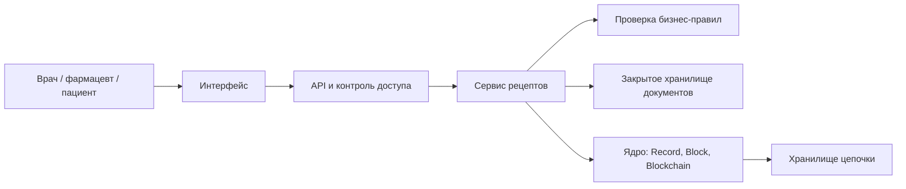
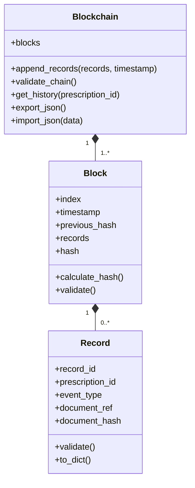
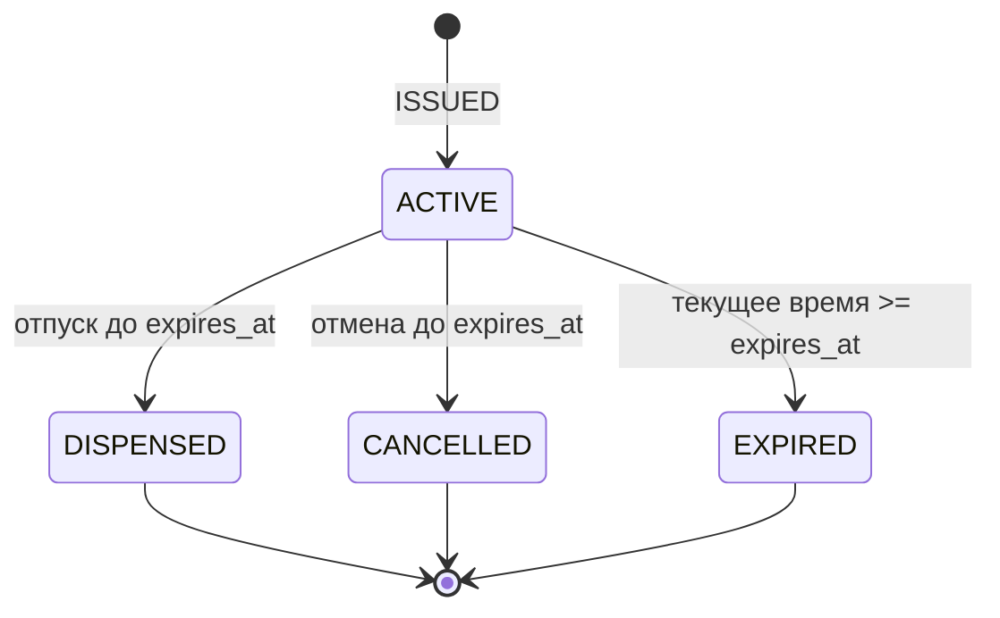

# Реестр медицинских рецептов на лекарства

## Материалы первого спринта

Предлагаемые решения рассчитаны на учебный проект и команду из пяти человек. Состав и роли указаны ниже. Длительность спринта, язык программирования и площадку репозитория нужно определить на установочной встрече. Документ содержит заготовки для доски и репозитория; внешняя доска и удалённый репозиторий этим документом не создаются.

## 1. Цель и границы

**Цель первого спринта:** договориться о процессе работы, распределить ответственность, изучить основы блокчейна и согласовать архитектуру и требования, достаточные для начала реализации ядра во втором спринте.

**Идея продукта:** хранить проверяемую историю событий рецепта: выписан, погашен при отпуске лекарства, отменён. Пользователь видит актуальное состояние и историю изменений.

**Учебное упрощение:** один рецепт содержит одну позицию лекарства и погашается целиком один раз. Частичный отпуск, несколько препаратов, исправление выписанного рецепта и интеграции с медицинскими системами находятся за пределами начальной версии. Ошибочный рецепт отменяется; новый получает новый идентификатор. Используются только синтетические данные.

Блокчейн здесь нужен для изучения связанной хешами истории и проверки её целостности. В перспективе участниками общей сети могут стать медицинские организации и аптеки. Первый прототип — локальная цепочка блоков с одним источником записи. Он ещё не обеспечивает распределённое согласование или защиту от администратора, переписавшего всю цепочку. Обычная база с журналом аудита остаётся возможной альтернативой для централизованного продукта.

NIST описывает блокчейн как распределённый журнал, в котором изменения обнаруживаются благодаря устройству цепочки и механизмам сети. Связывание хешами само по себе не гарантирует истинность исходной информации или подлинность автора. [Источник: NIST IR 8202](https://csrc.nist.gov/pubs/ir/8202/final).

## 2. Команда и рабочий процесс

| Участник | Основная роль | Ответственность в первом спринте | Дополнительная работа |
|---|---|---|---|
| Хисматуллин Ленар | Менеджер | Доска, репозиторий, встречи, зависимости и план второго спринта | Организация обзора результата и контроль загрузки |
| Бухаров Руслан | Технический писатель | Словарь, контракт данных, примеры, сборка документации | Проверка однозначности интерфейсов и ведение журнала консультаций |
| Боровкова Карина | Аналитик | Сценарии, бизнес-правила, ограничения, критерии приёмки | Проверка соответствия архитектуры сценариям |
| Кондратьева Эвелина | Специалист по тестированию и качеству | Сценарии проверки ядра, негативные случаи, тестовые данные и план демонстрации | Проверка воспроизводимости инструкций и проверяемости требований |
| Шайдаева Амина | Архитектор | Границы системы, компоненты, классы ядра, архитектурные решения | Рецензирование требований и контракта данных |

Роли Ленара и Карины заданы командой. Оставшиеся роли первоначально распределены случайным образом; затем по просьбе команды роли Руслана и Амины поменяны местами. В первом спринте специалист по тестированию готовит сценарии и критерии проверки; реализация ядра для этой работы не требуется.

У каждого результата один ответственный и один рецензент. Все участвуют в изучении блокчейна и согласовании решений. Роль технического писателя включает проектирование контракта, роль координатора — техническую подготовку проекта. После оценки задач команда выравнивает загрузку; количество карточек само по себе не считается мерой трудоёмкости.

**Доска:** «Бэклог → К выполнению → В работе → На проверке → Готово». Блокировки отмечаются меткой с причиной. Не более одной основной задачи в работе у каждого участника.

**Карточка:** идентификатор, цель, ответственный, рецензент, оценка, зависимости, результат или ссылка, критерии приёмки.

**Встречи:** планирование в начале спринта; короткая ежедневная синхронизация; обзор результата и ретроспектива в конце. Если ежедневная встреча неудобна, участники пишут в чат: что сделано, что дальше, что мешает.

**Готовность задачи к работе:** ясны результат, границы и критерии приёмки. **Готовность результата:** артефакт доступен, прошёл рецензию, замечания устранены, связанные документы обновлены. Для программного кода добавляются проверка сборки и необходимые тесты.

### Начальные карточки первого спринта

Все карточки ниже — заготовки, а не заявление о выполнении работ.

| ID | Задача | Ответственный / рецензент | Проверяемый результат |
|---|---|---|---|
| S1-01 | Создать доску и внести текущие работы | Ленар / Карина | У каждой карточки есть ответственный и критерии приёмки |
| S1-02 | Подготовить Git-репозиторий и правила изменений | Ленар / Амина | Все участники имеют доступ; выполнен пробный цикл ветка → запрос на слияние → проверка |
| S1-03 | Распределить роли и договориться о процессе | Ленар / Руслан | Записаны имена, обязанности, встречи и правила готовности |
| S1-04 | Разобрать основы блокчейна | Все; координация Амины | Команда объясняет хеш, блок, связь блоков, консенсус и ограничения локального прототипа |
| S1-05 | Описать сценарии и границы продукта | Карина / Амина | Согласованы акторы, три события и исключённые сценарии |
| S1-06 | Описать архитектуру и классы ядра | Амина / Руслан | Есть компонентная диаграмма, диаграмма классов и границы модулей |
| S1-07 | Согласовать формат данных и хеширования | Руслан / Амина | Определены поля, типы, сериализация, genesis-блок и ошибки |
| S1-08 | Подготовить требования и критерии приёмки | Карина / Эвелина | Каждое обязательное требование допускает проверку |
| S1-09 | Подготовить сценарии проверки целостности | Эвелина / Карина | Описаны порча записи, разрыв связи, повтор ID и некорректный genesis |
| S1-10 | Оформить документацию и журнал консультаций с ИИ | Руслан / Ленар | Документы связаны из README; решения команды отделены от предложений ИИ |
| S1-11 | Декомпозировать второй спринт | Все; координация Ленара | Задачи оценены, зависимости известны, загрузка согласована |
| S1-12 | Подготовить синтетические примеры и план демонстрации | Эвелина / Руслан | Есть корректные и ошибочные входные данные, ожидаемые результаты и порядок показа ядра |

### Подготовка репозитория

Предлагаемая структура:

```text
README.md
CONTRIBUTING.md
.gitignore
docs/
  architecture.md
  data-contract.md
  requirements.md
  team-process.md
  ai-consultations.md
  decisions/
src/
tests/
```

В README указать цель, участников, границы, навигацию по документации и порядок запуска, когда он появится. В CONTRIBUTING — правила веток и рецензирования. Рабочая ветка — `main`; изменения приходят через короткие тематические ветки и запросы на слияние с проверкой другим участником. Секреты, реальные рецепты и персональные данные в репозиторий не добавляются. Автоматические проверки кода подключаются после выбора языка и появления каркаса проекта.

## 3. Архитектура

### Компоненты и ответственность



Это целевая схема. Во втором спринте реализуются **ядро и тесты в памяти**. Интерфейс, HTTP API, контроль доступа, постоянное хранение, работа с несколькими узлами и электронные подписи относятся к последующим этапам.

Ядро проверяет структуру записей, хеши, связи и уникальность идентификаторов событий. Сервис рецептов впоследствии проверяет полномочия и допустимость действий с конкретным рецептом. Такая граница позволяет тестировать ядро независимо от медицинской предметной области.

В цепочке хранятся технические события и хеши документов. Сведения о пациенте, лекарстве, дозировке и другие подробности находятся в закрытом хранилище. Идентификатор документа — непрозрачный ключ, а не открытая ссылка. Даже технические идентификаторы могут позволять связывать события, поэтому разделение хранилищ не заменяет контроль доступа.

В будущей реализации сервис сначала сохраняет неизменяемую версию документа, затем добавляет ссылку и её хеш в цепочку. Успех пользователю возвращается после записи события. Сбой между операциями обрабатывается повтором с тем же `record_id` и сверкой результата; неподтверждённый документ не означает выписанный рецепт.

### Основные классы второго спринта



Диаграмма показывает ключевые поля; полный контракт ниже. Только genesis-блок может содержать ноль записей. Добавленный блок и его записи нельзя менять через публичный интерфейс; методы чтения возвращают неизменяемое представление или копию.

## 4. Сценарии и начальные требования по аналитике

Здесь аналитика означает описание предметной области, сценариев и требований.

| Актор | Сценарий | Ожидаемый результат |
|---|---|---|
| Врач | Выписать рецепт | Созданы документ и событие `ISSUED`; рецепт активен |
| Врач | Отменить ранее выписанный им активный рецепт | Добавлено событие `CANCELLED`; исходная запись сохранена |
| Фармацевт | Проверить рецепт и зарегистрировать отпуск | Для действующего активного рецепта добавлено `DISPENSED` |
| Пациент | Посмотреть свои рецепты | Доступны актуальное состояние и история собственных рецептов |
| Технический администратор | Проверить целостность цепочки | Получен результат проверки с местом ошибки; роль не даёт права выписывать рецепты |

Это проектная модель доступа; аутентификация и проверка полномочий не входят в ядро второго спринта.



`EXPIRED` — вычисляемое состояние: наступление срока само по себе не добавляет блок. Если рецепт ранее погашен или отменён, его конечный статус сохраняется. Действие разрешено строго до `expires_at`; порядок событий задаётся положением в цепочке, а не сортировкой по времени.

### Правила продукта для последующих этапов

| ID | Требование | Критерий приёмки |
|---|---|---|
| BR-01 | Для рецепта допускается ровно одно событие `ISSUED` | Повторная выписка с тем же `prescription_id` отклоняется |
| BR-02 | Погашается только активный непросроченный рецепт | Неизвестный, погашенный, отменённый или просроченный рецепт не погашается |
| BR-03 | Рецепт погашается целиком один раз | Второе погашение отклоняется; при двух конкурирующих запросах успешен только один |
| BR-04 | Отмена доступна выписавшему врачу для активного рецепта | Неподходящая роль, другой врач или конечное состояние дают отказ |
| BR-05 | История дополняется новыми событиями | Отмена не удаляет и не перезаписывает событие выписки |
| BR-06 | Подробности доступны по роли и связи с рецептом | Пациент не получает чужой рецепт; фармацевт получает разрешённые сведения для отпуска |
| BR-07 | Документ должен соответствовать хешу события | Изменённый документ определяется как несоответствующий и не используется для отпуска |

Проверку конкурирующего погашения нужно реализовать атомарно в сервисе рецептов при появлении API; наличие блокчейна само по себе её не обеспечивает.

### Обязательные требования к ядру второго спринта

| ID | Требование | Критерий приёмки |
|---|---|---|
| CORE-01 | Создание и проверка `Record` | Обязательные поля, типы, UUID, время, тип события и формат хеша проверяются; некорректные данные отклоняются |
| CORE-02 | Детерминированное хеширование | Одни и те же данные дают одинаковый хеш независимо от порядка ключей JSON |
| CORE-03 | Фиксированный genesis-блок | Две новые цепочки содержат одинаковый первый блок и его хеш |
| CORE-04 | Добавление блока | Индекс увеличен на один; `previous_hash` равен хешу последнего блока; список событий непустой |
| CORE-05 | Полная проверка цепочки | Проверяются genesis, индексы, поля, хеши, ссылки и уникальность `record_id`; ошибка локализована |
| CORE-06 | Защита от повторов | Повтор `record_id` внутри блока или ранее в цепочке отклоняется без изменения цепочки |
| CORE-07 | Получение истории | Возвращаются только события нужного рецепта в порядке блоков и записей; для неизвестного ID — пустой список |
| CORE-08 | Экспорт и импорт | JSON сохраняет содержимое и хеши; импорт повреждённых данных отклоняется целиком |
| CORE-09 | Неизменяемость через публичный интерфейс | Изменение исходного списка или результата чтения не меняет добавленный блок |
| CORE-10 | Атомарность добавления | Ошибка в любой записи оставляет цепочку в исходном состоянии |

Ядро допускает технически корректное событие `DISPENSED` без предшествующего `ISSUED`: предметную последовательность проверяет будущий сервис рецептов. Этот предел проверки должен быть прямо отражён в документации и демонстрации.

## 5. Соглашение о формате данных, версия 1

### Общие правила

- Обмен и экспорт: JSON в UTF-8; во втором спринте между классами передаются объекты, JSON используется на границах сериализации.
- Все перечисленные поля обязательны. Лишние поля, повторяющиеся ключи JSON, `null` и неизвестная версия отклоняются.
- Идентификаторы событий, рецептов, авторов и документов: UUID в нижнем регистре, формат `8-4-4-4-12`.
- Время: UTC, строго `YYYY-MM-DDTHH:mm:ss.SSSZ`, с проверкой календарной корректности. Пример: `2026-09-24T10:00:00.000Z`.
- Все хеши: SHA-256, 64 шестнадцатеричных символа в нижнем регистре.
- Перед хешированием JSON канонизируется по JCS, RFC 8785. Применяется совместимая библиотека и контрольные примеры; обычной сортировки ключей недостаточно для общего случая.
- Для `schema_version` разрешено только целое `1`, для индекса — целое от `0` до `9007199254740991`; логические значения числами не считаются.
- Порядок элементов массивов значим и сохраняется. Канонизация не должна изменять содержимое строк.

JCS задаёт воспроизводимое представление JSON для хеширования и подписания. [Источник: RFC 8785](https://www.rfc-editor.org/rfc/rfc8785).

### Запись `Record`

| Поле | Тип | Значение |
|---|---|---|
| `schema_version` | integer | `1` |
| `record_id` | string | Уникальный UUID события во всей цепочке |
| `prescription_id` | string | UUID рецепта, общий для его событий |
| `event_type` | string | `ISSUED`, `DISPENSED` или `CANCELLED` |
| `actor_id` | string | UUID автора; сам по себе не удостоверяет его личность |
| `created_at` | string | Время события |
| `document_ref` | string | UUID неизменяемого документа данного события |
| `document_hash` | string | Хеш канонического документа события |

Каждое событие ссылается на свой документ. Документ `ISSUED` содержит `schema_version`, `prescription_id`, `event_type`, `patient_id`, `doctor_id`, `medication_code`, `dosage_text`, `quantity`, `unit`, `issued_at`, `expires_at`, `nonce`. Количество — положительное целое; срок окончания позже выписки. `medication_code` в учебной версии берётся из локального синтетического справочника, `dosage_text` — непустая строка с вымышленными данными.

Для `DISPENSED` документ содержит `schema_version`, `prescription_id`, `event_type`, `pharmacist_id`, `pharmacy_id`, `dispensed_at`, `nonce`. Для `CANCELLED` — `schema_version`, `prescription_id`, `event_type`, `doctor_id`, `cancelled_at`, `reason`, `nonce`. Поля идентификаторов — UUID, текстовые поля непустые; `nonce` — случайное значение из 32 байт в виде 64 шестнадцатеричных символов. Оно хранится только с закрытым документом, чтобы затруднить перебор его предполагаемого содержимого по публичному хешу. Это не шифрование документа.

Хеш документа включает все его поля, в том числе `nonce`. Сервис сверяет ID рецепта, тип события, автора и время документа с соответствующей записью. Во втором спринте ядро только проверяет форму `document_hash`; наличие и содержание документа не проверяются.

### Блок `Block`

| Поле | Тип | Правило |
|---|---|---|
| `schema_version` | integer | `1` |
| `index` | integer | `0` у genesis, далее последовательно |
| `timestamp` | string | Время формирования блока |
| `previous_hash` | string | Хеш предыдущего блока |
| `records` | array of Record | Упорядоченный массив событий |
| `hash` | string | Хеш блока, вычисленный без этого поля |

Формула:

```text
block.hash = hex_lower(SHA256(UTF8(JCS({
  schema_version, index, timestamp, previous_hash, records
}))))
```

Хеш охватывает все поля всех записей. Собственного хеша записи в версии 1 нет. Дерево Меркла, майнинг, сложность и `nonce` блока не требуются. `nonce` закрытого документа имеет другое назначение и не связан с майнингом.

**Genesis:** `schema_version = 1`, `index = 0`, `timestamp = "2026-01-01T00:00:00.000Z"`, `previous_hash` — 64 нуля, `records = []`. Поле `hash` вычисляется общей формулой, а не заполняется нулями. Импорт должен проверять точное соответствие этому определению.

Время нового блока не раньше предыдущего, время каждой записи не позже времени своего блока. Равные временные метки допустимы. Проверка не зависит от текущих часов компьютера: исторические тестовые данные воспроизводимы.

### Контракты методов и ошибок

| Операция | Вход | Результат |
|---|---|---|
| `append_records` | Непустой список записей, время блока | Новый блок либо ошибка; изменение всей цепочки атомарно |
| `validate_chain` | Текущая цепочка | `{valid, errors}`; первая ошибка или пустой массив |
| `get_history` | UUID рецепта | Копия списка записей в порядке цепочки |
| `export_json` | Текущая цепочка | JSON-объект `{schema_version: 1, blocks: [...]}` |
| `import_json` | JSON-объект экспорта | Новая проверенная цепочка либо ошибка, без изменения существующей |

Ошибка имеет `code`, `message`, `path`; например: `{"code":"HASH_MISMATCH","message":"Хеш блока не совпадает","path":"blocks[2].hash"}`. На внешней границе детали закрытого документа не включаются в сообщение.

Коды: `INVALID_FORMAT`, `UNSUPPORTED_VERSION`, `INVALID_RECORD`, `DUPLICATE_RECORD`, `EMPTY_BLOCK`, `INVALID_GENESIS`, `INVALID_INDEX`, `INVALID_TIMESTAMP`, `PREVIOUS_HASH_MISMATCH`, `HASH_MISMATCH`. При нескольких дефектах возвращается первый: сначала формат экспорта и версия, затем блоки по порядку; внутри блока — структура, genesis/индекс/время, записи и повторы, ссылка, собственный хеш.

## 6. Заготовка планирования второго спринта

| ID | Задача | Зависимости | Результат приёмки |
|---|---|---|---|
| S2-01 | Каркас проекта, тестовая среда, автоматический запуск проверок | Выбран язык | Команда воспроизводимо запускает проверки |
| S2-02 | Реализовать `Record` и его валидацию | S2-01, контракт | CORE-01; позитивные и негативные примеры |
| S2-03 | Реализовать канонизацию и хеширование | S2-01, контракт | CORE-02; контрольные примеры с кириллицей и разным порядком ключей |
| S2-04 | Реализовать `Block` и genesis | S2-02, S2-03 | CORE-03; хеш покрывает все записи; блок не меняется извне |
| S2-05 | Реализовать добавление и чтение истории | S2-04 | CORE-04, CORE-06, CORE-07, CORE-09, CORE-10 |
| S2-06 | Реализовать полную проверку цепочки | S2-05 | CORE-05; повреждённые данные обнаруживаются |
| S2-07 | Реализовать JSON-импорт и экспорт | S2-06 | CORE-08; неверный импорт не меняет действующую цепочку |
| S2-08 | Собрать демонстрацию ядра и инструкцию запуска | S2-07 | Свежая копия проекта воспроизводит демонстрацию |

Оценки и исполнителей команда назначает после выбора языка и доступного времени. Ведущий каждой задачи пишет реализацию и необходимые тесты; тестирование не перекладывается целиком на одного участника.

**Демонстрация:** создать цепочку; добавить два блока с синтетическими событиями; показать историю; экспортировать и импортировать; изменить поле записи без пересчёта хеша и получить ошибку; попытаться повторно добавить `record_id` и убедиться, что длина цепочки не изменилась.

Отдельно показать предел модели: полный пересчёт подменённой локальной цепочки может пройти внутреннюю проверку. Для обнаружения такого переписывания понадобятся внешняя доверенная контрольная точка либо распределённый протокол и независимые участники.

## 7. Работа с ИИ-консультантом

Текущий чат можно использовать для архитектурных консультаций. Команда хранит в `docs/ai-consultations.md` дату, вопрос, краткий ответ, принятое решение и обоснование. Ответ ИИ становится архитектурным решением только после обсуждения командой.

Примеры вопросов:

1. Какие ошибки останутся незамеченными при проверке только собственного хеша блока?
2. Как отделить проверки структуры цепочки от правил медицинского рецепта?
3. Что произойдёт, если две аптеки попытаются погасить рецепт одновременно?
4. Как доказать подлинность автора события на следующем этапе?
5. Какие тесты подтвердят, что изменения входных объектов не меняют уже добавленный блок?

## 8. Критерии завершения первого спринта

- [ ] Создана общая доска; текущие работы внесены и имеют статусы.
- [ ] Создан репозиторий; участники проверили доступ и процесс рецензирования.
- [ ] Роли закреплены за конкретными людьми; нагрузка согласована.
- [ ] Команда объясняет основные принципы и ограничения блокчейна.
- [ ] Архитектура и границы второго спринта согласованы.
- [ ] Согласован контракт записи, блока, сериализации и ошибок.
- [ ] Требования имеют идентификаторы и критерии приёмки.
- [ ] Зафиксированы консультации с ИИ и принятые решения.
- [ ] Задачи второго спринта оценены и готовы к распределению.

На итоговом обзоре команда показывает доску, репозиторий, диаграммы, контракт данных и бэклог следующего спринта. Реализация ядра не является условием завершения первого спринта.
